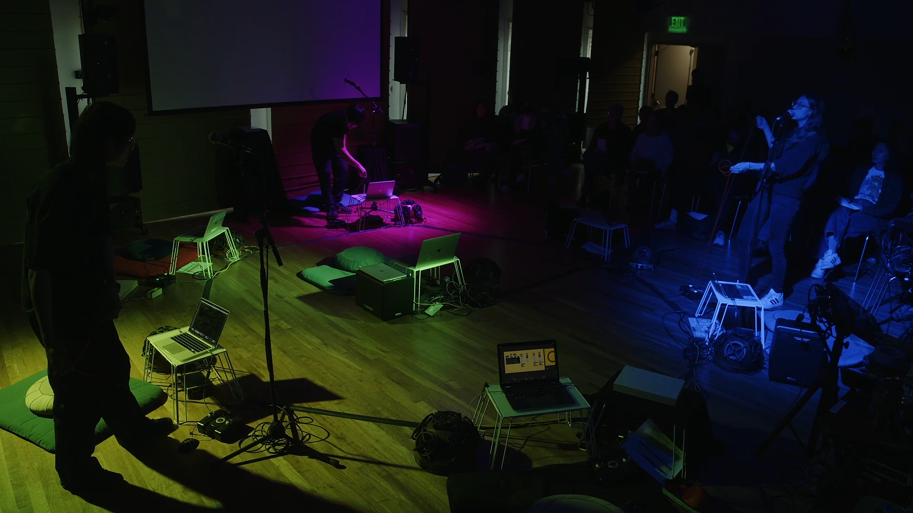
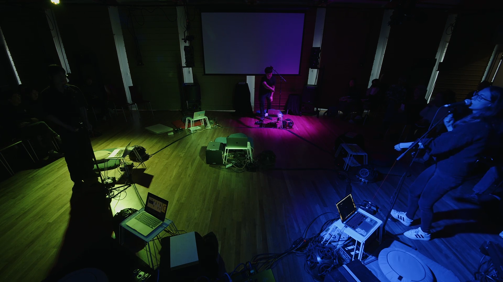
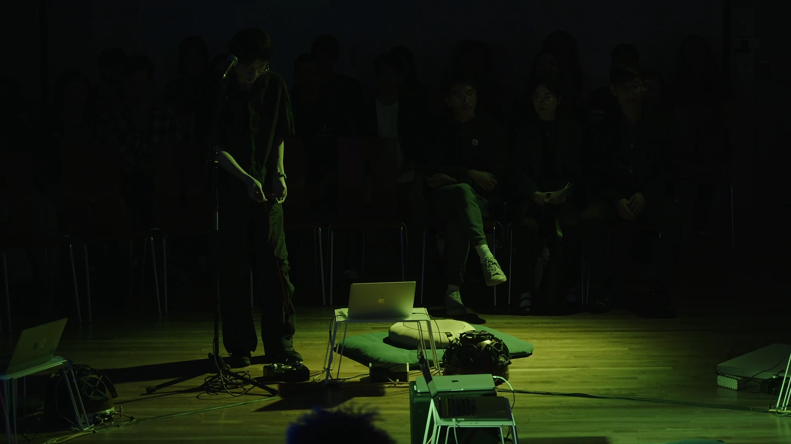

_5 min, ChucK & JackTrip, Stanford Laptop Orchestra (SLorK)_

Lejun Min, [Alex Han](https://ccrma.stanford.edu/~alexhan/), [Summer Krinsky](https://summerkrinsky.com/) 
Performed on [SLOrktastic Chamber Music 2026](https://slork.stanford.edu/events/2026/slorktastic/).

<iframe title="vimeo-player" src="https://player.vimeo.com/video/1186825513#t=5m31s" width="640" height="360" frameborder="0" referrerpolicy="strict-origin-when-cross-origin" allow="autoplay; fullscreen; picture-in-picture; clipboard-write; encrypted-media; web-share"   allowfullscreen></iframe>

Throwing ideas into the world and taking thoughts on as our own; when does the boundary between individual and influence blur? In this piece we amplify the uncertainty of self by capturing our own voices and then warping, sharing, stealing and accumulating each other’s vocalizations. Their collective meaning is created, transformed, and sometimes destroyed.

