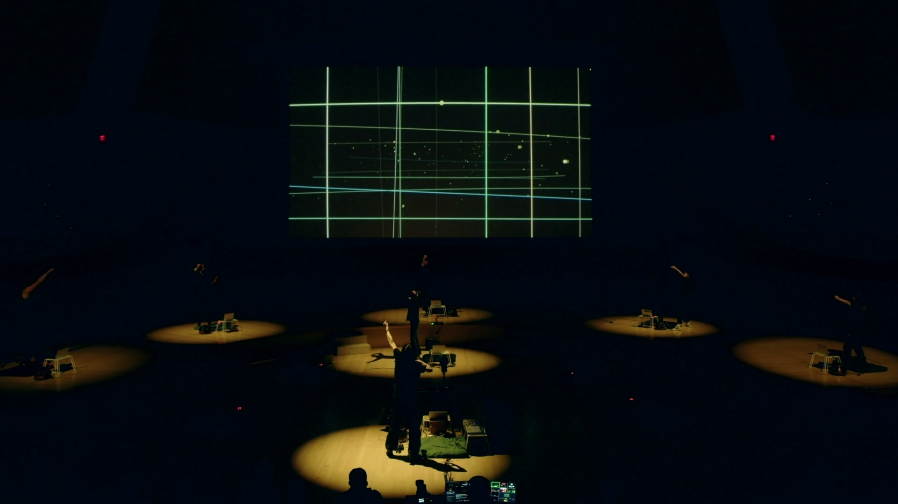
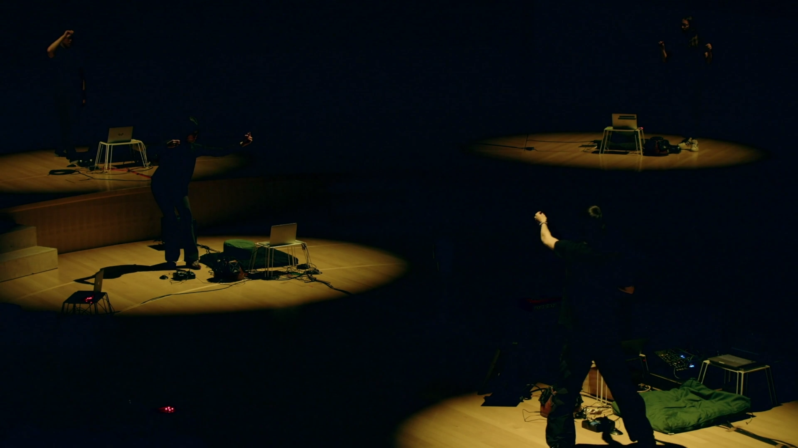
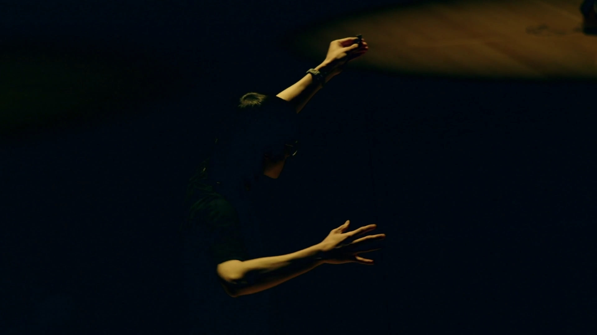
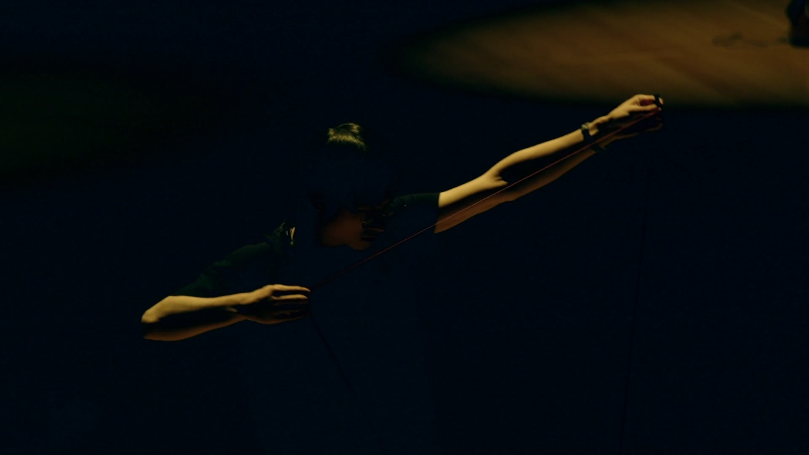

_5 min, ChucK & ChuGL, Stanford Laptop Orchestra (SLorK)_

Lejun Min, [Michelle Chen](https://morning-close.com) 
Presented at [Stanford Laptop Orchestra at Bing Concert Hall (2026)](https://slork.stanford.edu/events/2026/spring/).

You are only one individual. But together you can weave something that withstands time.

<iframe title="vimeo-player" src="https://player.vimeo.com/video/1190349246#t=30m04s" width="640" height="360" frameborder="0" referrerpolicy="strict-origin-when-cross-origin" allow="autoplay; fullscreen; picture-in-picture; clipboard-write; encrypted-media; web-share"   allowfullscreen></iframe>

_Weave_ is a performance piece that asks how we might stand together and face the ongoing disruptions in our world. Physical threads become virtual threads and sounds, transcending space and time. Performed with Michelle Chen, Alex Han, Anthony Maltsev, Héloïse Garry, Summer Krinsky, and Siqi Chen.

