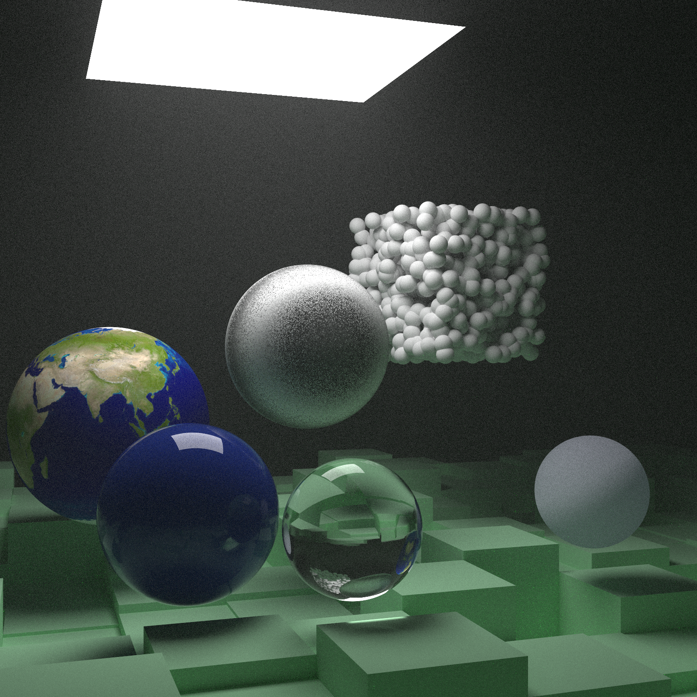
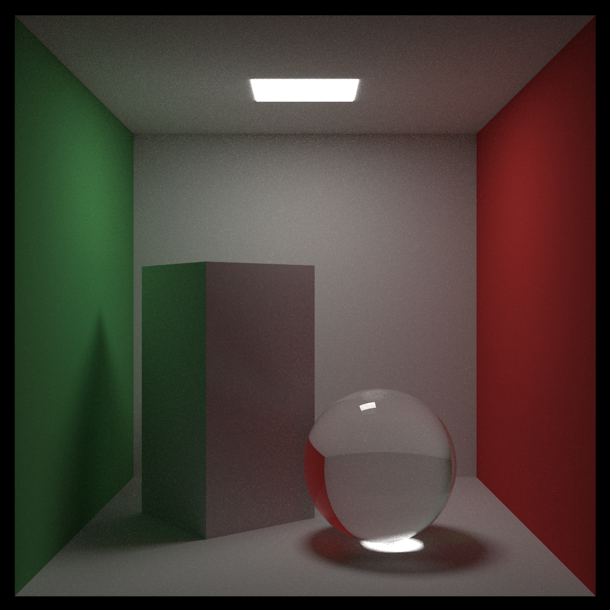
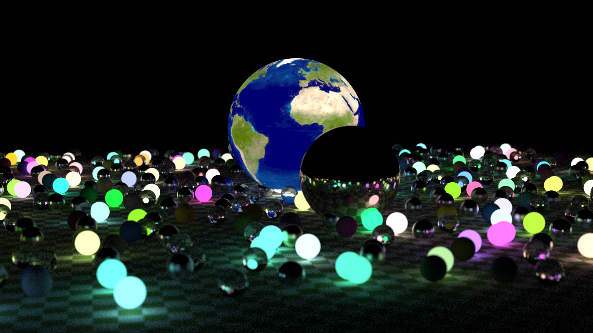
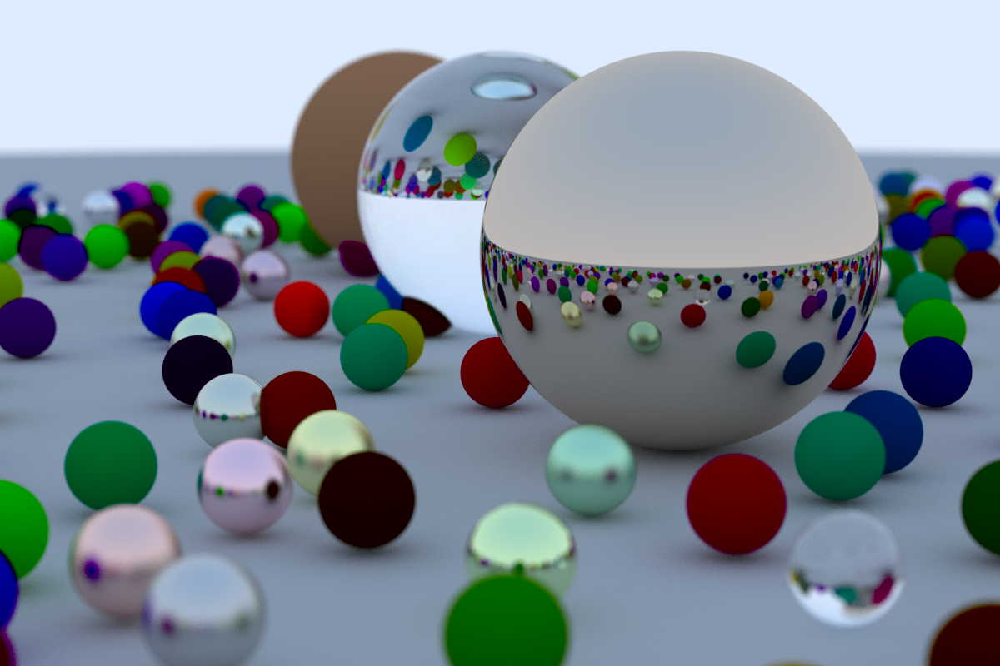
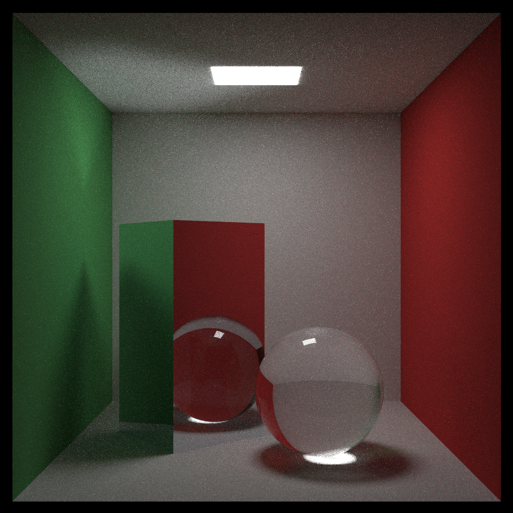

This is a project assigned in Principle and Practice of Computer Algorithms (CS1952) courses.

We built a hand-made ray tracer using the Rust programming language. Basically we followed the steps given by 
[this amazing tutorial](https://raytracing.github.io/), and we also added some cool features like multi-thread rendering, 
code generation and so forth. Check out my github repo [here](https://github.com/aik2mlj/RayTracing).

Since I also served as a teaching assistant of this course the next year, you can check [this](/teaching/2021-summer-ppca).

Here are some pictures generated by my ray tracer:

