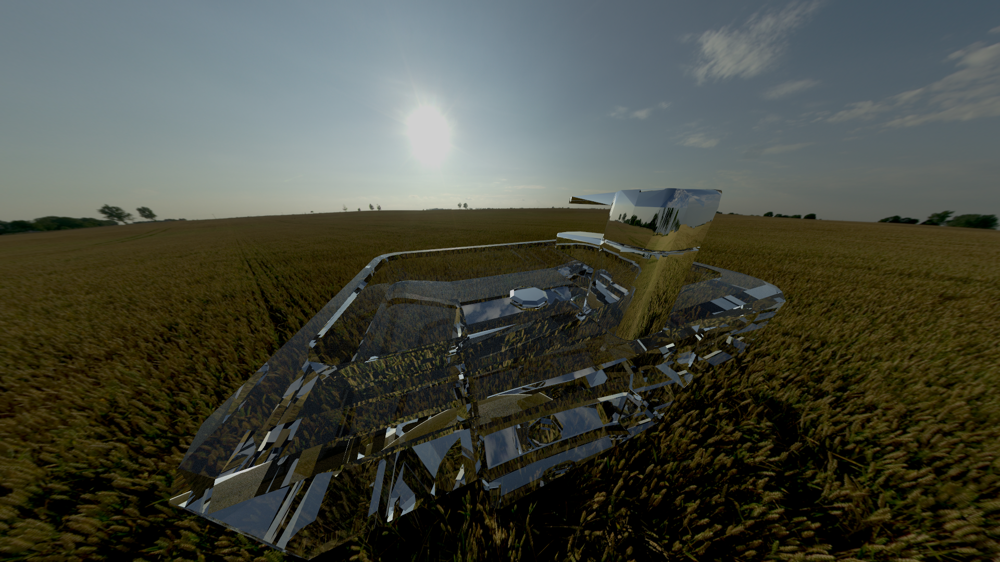
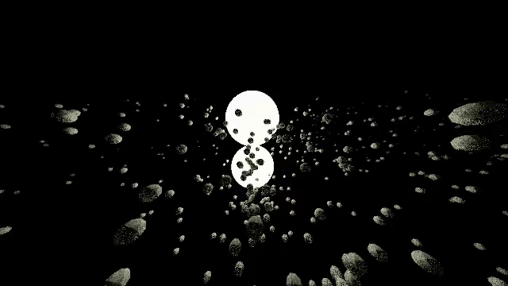
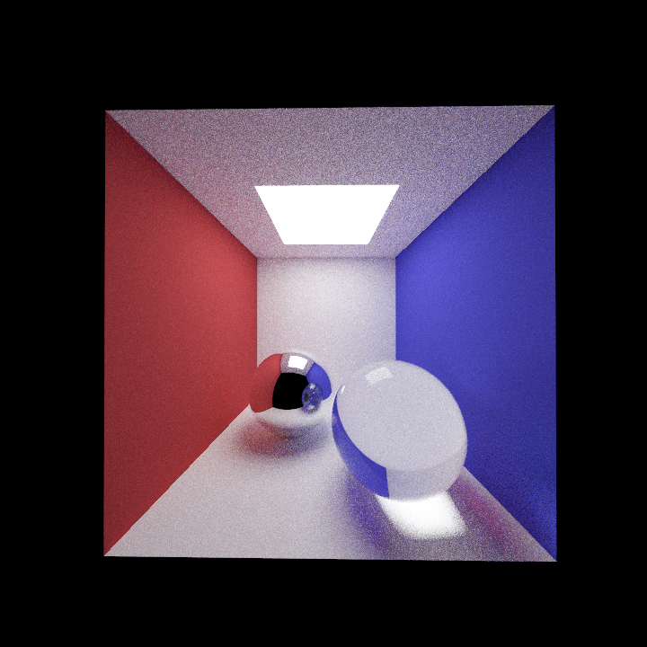

Scotty3D is a comprehensive CG project including interactive mesh editing, realistic path tracing, and dynamic animation. It is originally designed as a course project for CMU462 at CMU. Implementing functionality in each of these areas constitutes the coursework for CS403 (Computer Graphics) at SJTU.

My code is [here](https://github.com/aik2mlj/Scotty3D).
